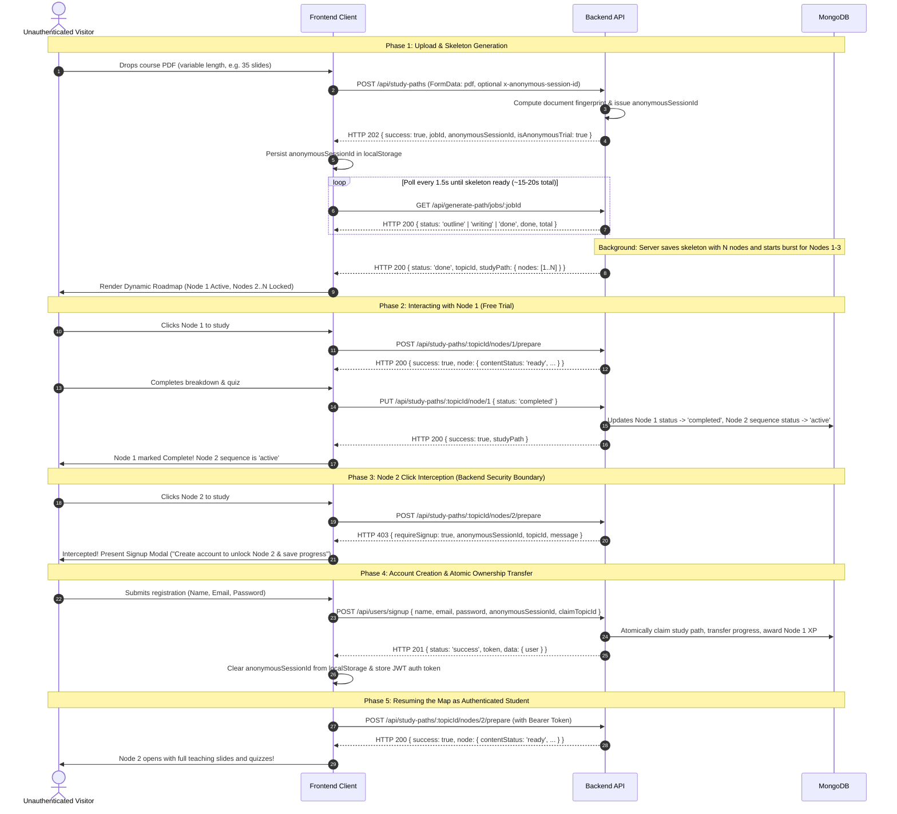

# StudyHelp Frontend Integration Guide: Study Maps, Adaptive Sizing & Anonymous Onboarding

> **Target Audience:** Senior Frontend Engineers integrating the StudyHelp Interactive Study Map engine into the web/mobile client.  
> **Backend Source of Truth:** Verified against `src/controllers/studyPathController.js`, `src/routes/studyPathRoutes.js`, `src/routes/slideRoutes.js`, `src/services/studyPathPdfPipeline.js`, `src/services/studyPathNodeService.js`, `src/services/anonymousSessionService.js`, and `tests/studyPathIntelligence.test.js`.

---

## 1. Executive Summary & Architectural Overview

The StudyHelp Study Map engine transforms uploaded course materials (PDFs, lecture slides, documents) into structured, interactive learning journeys.

### Key Architectural Behaviors

1. **Adaptive Roadmap Sizing (No Fixed Node Count):**
   - Study maps do **NOT** have a fixed 6-node roadmap.
   - Node count $N$ ($N \ge 1$) is dynamically determined by the source document's conceptual structure, subtopics, and complexity. Short documents may yield 3–6 nodes; dense slide decks may yield 12–25+ nodes.
   - Lessons are grouped into modules via the `unit` field (e.g., `"Unit 1: Structural Foundations"`).
   - Overly granular subtopics are merged; complex multi-topic sections are split into distinct nodes.
   - Complete document coverage is preserved without truncating content to fit an arbitrary limit.
   - Frontend components must dynamically render an arbitrary number of nodes without assuming 6 nodes.

2. **120-Node Operational Ceiling (Circuit Breaker):**
   - The safety ceiling of 120 nodes (`MAX_NODES = 120`) is an **operational circuit breaker** designed to protect backend memory and LLM token budgets from runaway hallucination loops or corrupted 500+ page documents.
   - It is **not** an instructional design target or silent truncation boundary.
   - If a document's outline ever exceeds 120 nodes, the backend throws an explicit error and marks the background job as `status: 'error'` with a clear message. The backend **never silently drops or truncates** learning material.

3. **Two-Stage Generation Lifecycle & Content States:**
   - **Job Completion (`status: 'done'`) Means Skeleton Ready:** When polling `/api/generate-path/jobs/:jobId` returns `status: 'done'`, it indicates that the **outline and skeleton roadmap** have been persisted to the database. It does **not** mean all $N$ lesson bodies are generated.
   - **Skeleton Node States:** In the initial roadmap:
     - Node 1 has progression sequence `status: 'active'`. Nodes 2..$N$ have `status: 'locked'`.
     - All nodes initially have empty lesson bodies (`breakdown: []`, `keyConcepts: []`, no `quiz`).
     - Nodes 1–3 start with `contentStatus: 'generating'`. Nodes 4..$N$ start with `contentStatus: 'pending'`.
   - **Initial Background Burst:** Immediately upon outline persistence, the server triggers an asynchronous background burst generating full teaching content for Nodes 1–3 concurrently (concurrency 3).
   - **On-Demand Node Content (`contentStatus`):**
     - `'generating'`: Initial burst or on-demand generation is in progress. The UI should display a loading spinner.
     - `'pending'`: Node outline exists; content has not yet been generated.
     - `'ready'`: Full lesson content (`breakdown` with 2 slides, `keyConcepts`, `quiz`, `quiz2`) is available and rendered.
     - `'failed'`: Generation encountered an error (`generationError`). The UI should show a "Retry" button calling `POST /api/study-paths/:topicId/nodes/:nodeId/retry`.
   - **Rolling Buffer:** Calling `POST /api/study-paths/:topicId/nodes/:nodeId/prepare` on Node $K$ awaits or retrieves that node's finalized content (`contentStatus: 'ready'`) and automatically pre-buffers Node $K+1$ in the background (`bufferNext: true`).

4. **Roadmap Click Handling: Sequencing Status vs. Guest Authorization:**
   - **Progression Sequence != Authorization:** In the roadmap sequence, completing Node 1 sets Node 2's status to `'active'`. However, unauthenticated guests are **never authorized** to access Node 2 or higher, even if its sequence status is `'active'` or `'completed'`.
   - **Backend as Authoritative Security Boundary:** When any node is clicked, the client calls `openNode(studyPath.topicId, node.id)` $\rightarrow$ `POST /api/study-paths/:topicId/nodes/:nodeId/prepare`. If a guest attempts to access Node 2+, the backend authoritatively returns `HTTP 403 Forbidden` (`{ success: false, requireSignup: true, anonymousSessionId, topicId, message }`), prompting the signup modal.
   - **Data Redaction in Map Responses:** `formatStudyPathResponse` redacts the teaching body (`breakdown: []`, `keyConcepts: []`, no `quiz`) for all nodes $\ge 2$ when viewed anonymously, preventing guests from scraping content via `GET /api/study-paths/:topicId`.
   - Guests are limited to **1 anonymous study map trial**. Attempting a second upload returns `HTTP 403` requiring signup.

5. **Retry Authorization & Node Restrictions:**
   - **Anonymous Users & Node 1:** Guests **can** retry Node 1 if its initial generation failed (`contentStatus === 'failed'`).
   - **Node 2+ Protected:** Anonymous users **cannot** retry Node 2 or higher; the endpoint strictly returns `HTTP 403 Forbidden` (`{ requireSignup: true }`). Retry cannot be used as an exploit to bypass signup.
   - **Ownership Enforced:** For authenticated users, `POST /api/study-paths/:topicId/nodes/:nodeId/retry` verifies that `pathRecord.userId` matches the caller. Users cannot trigger retries on study paths belonging to others (`HTTP 403 Forbidden`).

6. **Cache Hits vs. Background Generation:**
   - **Instant Rendering on Cache Hit:** When `POST /api/study-paths` returns `cached: true` along with `studyPath`, the frontend **must immediately render the returned study map** and bypass background job polling entirely.
   - **Complete Map Returned:** The returned `studyPath.nodes` array contains the full, complete list of $N$ nodes previously saved for that map. Any JSON snippets showing 1 or 2 nodes in this guide are abbreviated for documentation readability.
   - **Cross-User Privacy:** Cross-user caching reuses only document-level structural analysis (domain classification, blueprint patterns, collective student pitfalls). It **never** shares or transfers another student's study path, progress, notes, or scores.

7. **Account Claiming Architecture & Concurrency:**
   - **Single-Document Atomic Gatekeeper:** `claimAnonymousStudyPath` uses an atomic MongoDB `findOneAndUpdate` on `{ topicId, $or: [{ userId: 'anonymous-user' }, { isAnonymousTrial: true }] }` and resets `anonymousSessionId: null`.
   - **Separate Sequenced Operations:** Ownership transfer, AI usage increment (`incrementAIUsage`), transfer XP award (`awardXP`), and lifetime map count update (`incrementStudyMapUsage`) are executed as **separate, sequenced operations** (not wrapped in a single multi-document replica set transaction).
   - **Idempotency & Concurrency Safety:** Because `findOneAndUpdate` acts as the atomic gatekeeper, any concurrent duplicate requests (e.g., parallel signup, login, or claim requests) match 0 documents and return `null`. This guarantees that map usage and XP are incremented **strictly once**.
   - **Already-Owned Maps:** Because `topicId` is unique in MongoDB, updating `userId` claims ownership in place without key collisions. Subsequent duplicate claim calls return `HTTP 404 Not Found`.

8. **Slide Preview Canonical Route:**
   - The canonical `documentId` for all slide preview requests is **always** `studyPath.topicId`.
   - Canonical URL format: `/api/slides/:topicId/page-:page.:ext` (e.g., `/api/slides/brachial-plexus-anatomy/page-1.png` or `page-1.jpg`).
   - Every node returned by the backend already attaches this pre-formatted URL in `node.slideImage`. The frontend should simply bind ``.

9. **Lifetime Paywall Enforcement:**
   - Free accounts are capped at **3 lifetime study maps**.
   - Attempting a 4th map without an active subscription returns `HTTP 403 PAYWALL_TRIGGERED`.

---

## 2. Updated TypeScript Interfaces

```typescript
// ============================================================================
// 1. Core Study Map & Node Contracts
// ============================================================================

export type DomainDiscipline =
  | 'medicine'
  | 'stem'
  | 'law'
  | 'business'
  | 'humanities'
  | 'general';

export type NodeProgressionStatus = 'locked' | 'active' | 'completed';
export type NodeContentStatus = 'pending' | 'generating' | 'ready' | 'failed';
export type ChallengeStatus = 'locked' | 'active' | 'completed';

export interface BreakdownSlide {
  heading: string;
  body: string;
  memoryTip?: string;
}

export interface QuizQuestion {
  question: string;
  options: string[]; // Exactly 4 non-empty options
  correctAnswerIndex: number; // 0..3
  explanation: string;
}

export interface StudyPathNode {
  id: number; // 1-based sequential node ID
  title: string;
  unit: string; // Module or thematic grouping (e.g., "Unit 1: Structural Foundations")
  status: NodeProgressionStatus; // 'active' in progression sequence, 'locked', 'completed'
  contentStatus: NodeContentStatus; // 'generating' | 'pending' in skeleton, 'ready' when content is prepared, 'failed' on error
  generationError?: string | null;
  duration: string; // e.g., "5 min"
  xp: number; // e.g., 20 - 35 XP
  slideImage: string; // Canonical URL: e.g., "/api/slides/brachial-plexus-anatomy/page-1.png"
  sourcePages: number[]; // Original slide numbers from the PDF (e.g., [1, 2])
  sourceFacts?: string[]; // Grounded factual claims extracted from document
  summary: string;
  breakdown: BreakdownSlide[]; // Empty array [] in skeleton or when gated; populated with 2 slides when contentStatus === 'ready'
  keyConcepts: string[]; // Empty array [] in skeleton or when gated; populated when contentStatus === 'ready'
  quiz?: QuizQuestion; // Present when contentStatus === 'ready' and authorized
  quiz2?: QuizQuestion; // Present when contentStatus === 'ready' and authorized
}

export interface ChallengeMeta {
  status: ChallengeStatus;
  questionCount: number; // Standard: 10 questions
  passMark: number; // Standard: 7
  maxXp: number; // Standard: 100
  bestScore: number;
  bestXp: number;
}

export interface DocumentClassification {
  discipline: DomainDiscipline;
  documentType?: string;
  cognitiveDensity?: string;
}

export interface StudyPathResponse {
  topicId: string; // Slugified identifier and canonical documentId (e.g., "brachial-plexus-anatomy")
  title: string;
  courseCode: string; // e.g., "BRACHI 101 · Interactive Study Path"
  currentProgress: number; // Number of completed nodes
  completed: boolean; // True if all nodes completed or challenge passed
  challenge: ChallengeMeta;
  nodes: StudyPathNode[]; // Dynamic N nodes (adaptive, determined by document content)
  classification?: DocumentClassification;
}

// ============================================================================
// 2. Job & Polling Payloads
// ============================================================================

export interface JobInitResponse {
  success: boolean;
  jobId: string;
  anonymousSessionId?: string; // Server-sanitized guest session ID (anon_<32hex>)
  isAnonymousTrial?: boolean;
  cached?: boolean; // True if returned instantly from SHA-256 fingerprint cache
  topicId?: string; // Present on instant cache hit
  studyPath?: StudyPathResponse; // Present on instant cache hit (complete N-node roadmap)
}

export interface JobStatusResponse {
  success: boolean;
  jobId: string;
  status: 'queued' | 'outline' | 'writing' | 'done' | 'error';
  stage: string; // Descriptive UI string (e.g., "Reading slides... extracting outline (~15s)")
  done: number; // Number of nodes processed
  total: number; // Total nodes in study map
  topicId?: string; // Present when status === 'done'
  studyPath?: StudyPathResponse; // Initial skeleton map when status === 'done'
  message?: string; // Descriptive error message when status === 'error'
}

// ============================================================================
// 3. Error Payloads
// ============================================================================

export interface GateRequireSignupError {
  success: false;
  requireSignup: true;
  anonymousSessionId: string;
  topicId: string;
  message: string; // e.g., "Create a free account to unlock Node 2 and keep your progress!"
}

export interface PaywallTriggeredError {
  success: false;
  error: 'PAYWALL_TRIGGERED';
  code: 'PAYWALL_TRIGGERED';
  message: string;
  showUpgrade: true;
  upgradeRequired: true;
  total_maps_created: number;
  limit: number; // 3 for free tier
}

export interface NodePrepareResponse {
  success: boolean;
  node: StudyPathNode;
}
```

---

## 3. End-to-End Workflow Diagram



---

## 4. Endpoint Specifications & Canonical Routes

### 4.1 Canonical Endpoints vs. Aliases

| Action | Canonical Endpoint | Supported Aliases | Notes |
| :--- | :--- | :--- | :--- |
| **Upload / Generate** | `POST /api/study-paths` | `POST /api/generate-path`, `POST /api/generate-path/generate`, `POST /api/study-path` | All route to `generateStudyPath` controller. |
| **Job Polling** | `GET /api/generate-path/jobs/:jobId` | `GET /api/jobs/:jobId` | Both route to `getStudyPathJobStatus`. |
| **Get Study Path** | `GET /api/study-paths/:topicId` | `GET /api/study-path/:topicId`, `GET /api/generate-path/:topicId` | Returns study path formatted by `formatStudyPathResponse`. |
| **Prepare Node** | `POST /api/study-paths/:topicId/nodes/:nodeId/prepare` | `POST /api/generate-path/:topicId/nodes/:nodeId/prepare` | Generates node content & buffers next node. |
| **Retry Node** | `POST /api/study-paths/:topicId/nodes/:nodeId/retry` | N/A | Guests can retry Node 1; Node 2+ requires signup. |
| **Update Node Status** | `PUT /api/study-paths/:topicId/node/:nodeId` | `PUT /api/generate-path/:topicId/node/:nodeId` | Advances sequence ($K \rightarrow K+1$). |
| **Claim Anonymous Map** | `POST /api/study-paths/claim` | `POST /api/users/signup` (via body payload), `POST /api/users/login` | Atomically transfers guest ownership to authenticated user. |
| **Slide Previews** | `GET /api/slides/:topicId/page-:page.:ext` | N/A | `:topicId` is the canonical `documentId`. |

---

### 4.2 Document Upload & Job Initialization

- **Canonical Endpoint:** `POST /api/study-paths`
- **Method:** `POST`
- **Content-Type:** `multipart/form-data`
- **Headers:**
  - `Authorization: Bearer <jwt_token>` (Optional — omit for guests)
  - `x-anonymous-session-id: anon_<32_hex_chars>` (Optional — pass if guest has existing session)
- **Form Data Fields:**
  - `pdf` (or `file`, `document`): Binary File (max 50MB)
  - `title`: Optional custom title string
  - `anonymousSessionId`: Optional string (alternative to header)

#### Response 1: Background Generation Started (`HTTP 202 Accepted`)
```json
{
  "success": true,
  "jobId": "job-1731189400000-8f92a1",
  "anonymousSessionId": "anon_9b3e1c07a4f5d6e81234567890abcdef",
  "isAnonymousTrial": true
}
```

#### Response 2: Instant Cache Hit (`HTTP 202 Accepted`)
*Occurs when the same authenticated user re-uploads an identical document (typical lookup latency 50–300ms). The frontend immediately renders this complete roadmap without job polling:*
```json
{
  "success": true,
  "jobId": "job-1731189400000-cache01",
  "cached": true,
  "topicId": "brachial-plexus-anatomy",
  "studyPath": {
    "topicId": "brachial-plexus-anatomy",
    "title": "Brachial Plexus Anatomy",
    "courseCode": "BRACHI 101 · Interactive Study Path",
    "currentProgress": 1,
    "completed": false,
    "challenge": {
      "status": "locked",
      "questionCount": 10,
      "passMark": 7,
      "maxXp": 100,
      "bestScore": 0,
      "bestXp": 0
    },
    "nodes": [
      {
        "id": 1,
        "title": "Roots and Trunks Formation",
        "unit": "Unit 1: Structural Foundations",
        "status": "completed",
        "contentStatus": "ready",
        "duration": "5 min",
        "xp": 25,
        "slideImage": "/api/slides/brachial-plexus-anatomy/page-1.png",
        "sourcePages": [1, 2],
        "summary": "The brachial plexus begins with ventral rami C5-T1 forming three primary trunks.",
        "breakdown": [
          {
            "heading": "Roots of the Plexus",
            "body": "The five roots emerge from anterior rami of spinal nerves **C5 through T1** because they provide motor and sensory innervation to the entire upper extremity.",
            "memoryTip": "Remember C5-T1 as the spinal powerhouse of the arm."
          },
          {
            "heading": "Trunk Organization",
            "body": "Superior and middle trunks merge at the posterior triangle, which means proximal lesions directly compromise shoulder abduction and elbow flexion.",
            "memoryTip": "Superior trunk is formed by C5 and C6."
          }
        ],
        "keyConcepts": [
          "Roots: Emerge from C5-T1 intervertebral foramina",
          "Trunks: Superior, Middle, and Inferior divisions located in neck"
        ],
        "quiz": {
          "question": "Which spinal roots contribute to the formation of the superior trunk?",
          "options": ["C5 and C6", "C7 and C8", "C8 and T1", "C5 only"],
          "correctAnswerIndex": 0,
          "explanation": "The superior trunk is formed by the union of anterior rami of C5 and C6."
        },
        "quiz2": {
          "question": "What is the primary anatomical relation of the brachial plexus trunks?",
          "options": ["Posterior triangle of the neck", "Cubital fossa", "Axillary sheath distal to clavicle", "Carpal tunnel"],
          "correctAnswerIndex": 0,
          "explanation": "The trunks reside in the posterior triangle of the neck between the scalene muscles."
        }
      }
      // ... Note: Full complete list of N nodes is returned in this payload (abbreviated here for documentation)
    ]
  }
}
```

---

### 4.3 Job Polling & Lifecycle Expectations

- **Canonical Endpoint:** `GET /api/generate-path/jobs/:jobId`
- **Polling Frequency:** Recommend polling every 1.5 seconds.
- **Job States:**
  - `queued`: Request queued.
  - `outline`: Reading slides and extracting outline (~15s).
  - `writing`: Persisting skeleton roadmap (~1s).
  - `done`: Skeleton roadmap ready. Returns `topicId` and initial skeleton `studyPath`.
  - `error`: Outline generation failed. Returns `message`.
- **Job Expiration (TTL):** In-memory job state is retained for 1 hour (`STUDY_PATH_JOB_TTL_MS = 3600000`). Polling an expired job returns `HTTP 404 Not Found`.
- **Handling Expired Job IDs Without Duplicate Map Creation:**
  - If a job polling request returns `404`, the frontend should **not** immediately blind re-upload the PDF (which could waste lifetime map quotas).
  - Instead, the client should query `GET /api/study-paths/active` or inspect `GET /api/study-paths/all` by title or file name to check if the map finished and was saved before the job state expired.
  - Only prompt the user to re-upload if no active map exists.

---

### 4.4 Preparing Node Content & Pre-Buffering

- **Canonical Endpoint:** `POST /api/study-paths/:topicId/nodes/:nodeId/prepare`
- **Method:** `POST`
- **Headers:**
  - `Authorization: Bearer <jwt_token>` (Required for Node $\ge 2$)
  - `Content-Type: application/json`
- **Request Body:**
```json
{
  "bufferNext": true
}
```

#### Successful Response (`HTTP 200 OK`):
```json
{
  "success": true,
  "node": {
    "id": 1,
    "title": "Roots and Trunks Formation",
    "unit": "Unit 1: Structural Foundations",
    "status": "active",
    "contentStatus": "ready",
    "duration": "5 min",
    "xp": 25,
    "slideImage": "/api/slides/brachial-plexus-anatomy/page-1.png",
    "sourcePages": [1, 2],
    "summary": "The brachial plexus begins with ventral rami C5-T1 forming three primary trunks.",
    "breakdown": [ ... ],
    "keyConcepts": [ ... ],
    "quiz": { ... },
    "quiz2": { ... }
  }
}
```

#### Node 2+ Signup Interception Response (`HTTP 403 Forbidden`):
```json
{
  "success": false,
  "requireSignup": true,
  "anonymousSessionId": "anon_9b3e1c07a4f5d6e81234567890abcdef",
  "topicId": "brachial-plexus-anatomy",
  "message": "Create a free account to unlock Node 2 and keep your progress!"
}
```

---

### 4.5 Retrying a Failed Node

- **Canonical Endpoint:** `POST /api/study-paths/:topicId/nodes/:nodeId/retry`
- **Method:** `POST`
- **Headers:** `Authorization: Bearer <jwt_token>` (if authenticated)
- **Authorization & Ownership Rules:**
  - **Guests:** Unauthenticated guests can retry Node 1 if its initial generation failed. Any guest attempt to retry Node 2+ returns `HTTP 403 Forbidden` (`requireSignup: true`).
  - **Authenticated Users:** Verified that the user owns the study path. Attempts to retry nodes on maps belonging to other users return `HTTP 403 Forbidden`.
- **Response (`HTTP 200 OK`):**
```json
{
  "success": true,
  "node": {
    "id": 1,
    "title": "Roots and Trunks Formation",
    "contentStatus": "ready",
    "generationError": null,
    ...
  }
}
```

---

### 4.6 Updating Node Progression Status

- **Canonical Endpoint:** `PUT /api/study-paths/:topicId/node/:nodeId`
- **Method:** `PUT`
- **Headers:** `Content-Type: application/json`, optional `Authorization: Bearer <jwt_token>`
- **Request Body:**
```json
{
  "status": "completed"
}
```
- **Response (`HTTP 200 OK`):**
```json
{
  "success": true,
  "studyPath": {
    "topicId": "brachial-plexus-anatomy",
    "currentProgress": 1,
    "nodes": [
      { "id": 1, "status": "completed", ... },
      { "id": 2, "status": "active", ... },
      { "id": 3, "status": "locked", ... }
    ]
  }
}
```

---

### 4.7 Slide Image Previews

- **Canonical Endpoint:** `GET /api/slides/:topicId/page-:page.:ext`
- **Canonical Document ID:** Always `topicId` (e.g., `/api/slides/brachial-plexus-anatomy/page-1.png` or `page-1.jpg`).
- **Page Number (`:page`):** 1-based positive integer.
- **Supported Extensions (`:ext`):** `png` and `jpg`.
- **Response Headers:**
  - `Content-Type: image/jpeg`
  - `Cache-Control: public, max-age=604800, immutable` (7 days cache)
- **Disk Caching:** Stored at `uploads/slide-cache/${topicId}_p${page}.jpg`. The first request renders via pdfjs/canvas, subsequent requests stream directly from disk.
- **Authentication:** Public (no auth required).

---

### 4.8 Account Claiming & Concurrency Architecture

When a guest user registers or logs in, pass `anonymousSessionId` and `claimTopicId`:

```json
// POST /api/users/signup or POST /api/users/login
{
  "name": "Jane Doe",
  "email": "jane.doe@example.com",
  "password": "SecurePassword123!",
  "anonymousSessionId": "anon_9b3e1c07a4f5d6e81234567890abcdef",
  "claimTopicId": "brachial-plexus-anatomy"
}
```

#### Actual Claiming Behavior & Edge Cases:
1. **Session-Tied Atomic Gatekeeper:** Ownership transfer on `StudyPath` is executed via an atomic `findOneAndUpdate` matching `{ topicId, anonymousSessionId: cleanAnonId, $or: [{ userId: 'anonymous-user' }, { isAnonymousTrial: true }] }`. This strictly prevents anyone from claiming a map using just a topicId without possessing the valid guest `anonymousSessionId`. Upon transfer, `claimedSessionId` is durably recorded and `anonymousSessionId` is cleared.
2. **Crash Consistency & Durable Idempotency:** MongoDB standalone and non-replica-set deployments do not support multi-document transactions. To guarantee crash consistency, `StudyPath` tracks `claimState: { claimedAt: Date, xpAwarded: Boolean, usageCounted: Boolean }`. The AI usage increment (`incrementAIUsage`), transfer XP award (`awardXP`), and lifetime map count update (`incrementStudyMapUsage`) execute as sequenced operations, persisting their completion flags.
3. **Idempotent Replay vs Conflict Resolution:**
   - **Idempotent Replay (Same Owner):** If a network timeout or crash occurs during claiming, repeating the claim with the same `anonymousSessionId` finds `claimedSessionId === cleanAnonId` and `userId === user._id`. It safely completes any pending XP or usage steps and returns `HTTP 200 OK` (`alreadyClaimed: true`) without double-awarding XP or usage.
   - **Conflict (Different User):** If another account has already claimed that session's map, the endpoint rejects the attempt with `HTTP 409 Conflict`.
   - **Unclaimable / Not Found:** If no matching study path exists or it has already been claimed by an unknown session, returns `HTTP 404 Not Found`.
   - **Invalid Session Format:** If `anonymousSessionId` is missing or does not match `anon_[a-f0-9]{32}`, returns `HTTP 400 Bad Request`.
4. **Registration / Login Non-Blocking:** In `POST /api/users/signup` and `POST /api/users/login`, map claiming is performed gracefully: if claiming fails (e.g. expired session), authentication still succeeds.

---

### 4.9 Paywall Enforcement (`PAYWALL_TRIGGERED`)

- **Free Account Limit:** 3 lifetime study maps (`total_maps_created >= 3`).
- **What Counts Toward the Limit:**
  - Successful generation of a new study map (`persistSkeletonPdfPath`).
  - Claiming an anonymous study map (`claimAnonymousStudyPath`).
- **What Does NOT Count:**
  - **Cache hits:** Re-uploading an existing document hits the fingerprint cache and does not increment usage.
  - **Failed generations:** If outline processing fails, the request aborts before persistence; quota is not consumed.
  - **Deleted maps:** Deleting a map removes the document record but does **not** decrement `total_maps_created` (lifetime count).

#### Paywall Triggered Response (`HTTP 403 Forbidden`):
```json
{
  "success": false,
  "error": "PAYWALL_TRIGGERED",
  "code": "PAYWALL_TRIGGERED",
  "message": "You have reached the free lifetime limit of 3 study maps. Upgrade to create unlimited study maps.",
  "showUpgrade": true,
  "upgradeRequired": true,
  "total_maps_created": 3,
  "limit": 3
}
```

---

## 5. Frontend Implementation Walkthrough

### 5.1 Dynamic Roadmap Component with Backend-Driven Access Control

```tsx
// components/StudyRoadmap.tsx
import React from 'react';
import { StudyPathResponse, StudyPathNode } from '@/types/studyPath';

interface StudyRoadmapProps {
  studyPath: StudyPathResponse;
  isAuthenticated: boolean;
  onOpenNode: (node: StudyPathNode) => void;
  onRetryNode?: (nodeId: number) => void;
}

export const StudyRoadmap: React.FC<StudyRoadmapProps> = ({
  studyPath,
  isAuthenticated,
  onOpenNode,
  onRetryNode
}) => {
  // Group variable N nodes by their unit module
  const unitsMap = studyPath.nodes.reduce<Record<string, StudyPathNode[]>>((acc, node) => {
    const unitName = node.unit || 'Core Topics';
    if (!acc[unitName]) acc[unitName] = [];
    acc[unitName].push(node);
    return acc;
  }, {});

  return (
    <div className="study-roadmap-container py-8 max-w-3xl mx-auto">
      <header className="mb-6">
        <h1 className="text-2xl font-bold text-gray-900">{studyPath.title}</h1>
        <p className="text-sm text-gray-500">{studyPath.courseCode} · {studyPath.nodes.length} Lessons</p>
      </header>

      {Object.entries(unitsMap).map(([unitTitle, nodes], unitIndex) => (
        <section key={unitTitle} className="mb-8">
          <div className="unit-header flex items-center gap-2 mb-4">
            <span className="text-xs uppercase tracking-wider font-semibold text-blue-600 bg-blue-50 px-2 py-1 rounded">
              Module {unitIndex + 1}
            </span>
            <h2 className="text-lg font-semibold text-gray-800">{unitTitle}</h2>
          </div>

          <div className="nodes-stack space-y-3">
            {nodes.map((node) => {
              // Crucial: Progression sequence 'active' does NOT equal authorization for guests!
              // Guests must not enter Node 2+ even if status is 'active' or 'completed'.
              const isLockedInSequence = node.status === 'locked';
              const isGatedGuestNode = !isAuthenticated && node.id >= 2;

              return (
                <div
                  key={node.id}
                  onClick={() => {
                    // Prevent clicking sequence-locked nodes
                    if (isLockedInSequence) return;

                    // Pass click to onOpenNode: The backend authoritatively returns 403 requireSignup for guests!
                    onOpenNode(node);
                  }}
                  className={`p-4 rounded-xl border transition-all flex items-center justify-between ${
                    isLockedInSequence
                      ? 'border-gray-200 bg-gray-50 opacity-60 cursor-not-allowed'
                      : isGatedGuestNode
                      ? 'border-amber-300 bg-amber-50/40 hover:bg-amber-50 cursor-pointer shadow-sm'
                      : node.status === 'completed'
                      ? 'border-emerald-300 bg-emerald-50/50 hover:bg-emerald-50 cursor-pointer'
                      : 'border-blue-500 bg-white shadow-md hover:border-blue-600 cursor-pointer'
                  }`}
                >
                  <div className="flex items-center gap-4">
                    <div className={`w-8 h-8 rounded-full flex items-center justify-center font-bold text-sm ${
                      node.status === 'completed' && !isGatedGuestNode ? 'bg-emerald-500 text-white' :
                      isGatedGuestNode ? 'bg-amber-500 text-white' :
                      node.status === 'active' ? 'bg-blue-600 text-white' : 'bg-gray-300 text-gray-600'
                    }`}>
                      {node.status === 'completed' && !isGatedGuestNode ? '✓' : isGatedGuestNode ? '🔒' : node.id}
                    </div>
                    <div>
                      <h3 className="font-medium text-gray-900">{node.title}</h3>
                      <p className="text-xs text-gray-500">{node.duration} · {node.xp} XP</p>
                    </div>
                  </div>

                  <div className="flex items-center gap-2">
                    {/* Content Status Indicators */}
                    {node.contentStatus === 'generating' && (
                      <span className="text-xs text-blue-600 animate-pulse flex items-center gap-1">
                        <span className="w-2 h-2 rounded-full bg-blue-600"></span> Generating...
                      </span>
                    )}

                    {node.contentStatus === 'failed' && onRetryNode && (
                      <button
                        onClick={(e) => {
                          e.stopPropagation();
                          onRetryNode(node.id);
                        }}
                        className="text-xs bg-red-100 text-red-700 px-2 py-1 rounded hover:bg-red-200"
                      >
                        Retry Lesson
                      </button>
                    )}

                    {/* Progression & Access Badges */}
                    <div className="status-badge text-xs font-semibold">
                      {isGatedGuestNode ? (
                        <span className="text-amber-800 bg-amber-100 px-2 py-0.5 rounded">Sign Up to Unlock</span>
                      ) : node.status === 'completed' ? (
                        <span className="text-emerald-700">Completed</span>
                      ) : node.status === 'active' ? (
                        <span className="text-blue-700">Start Lesson</span>
                      ) : (
                        <span className="text-gray-500">🔒 Locked</span>
                      )}
                    </div>
                  </div>
                </div>
              );
            })}
          </div>
        </section>
      ))}
    </div>
  );
};
```

---

### 5.2 Node Access & Signup Interception Hook

```typescript
// hooks/useNodeAccess.ts
import { useState } from 'react';
import { StudyPathNode } from '@/types/studyPath';

export function useNodeAccess() {
  const [signupModalOpen, setSignupModalOpen] = useState(false);
  const [loadingNodeId, setLoadingNodeId] = useState<number | null>(null);
  const [pendingGate, setPendingGate] = useState<{ topicId: string; nodeId: number } | null>(null);

  const openNode = async (topicId: string, nodeId: number): Promise<StudyPathNode | null> => {
    setLoadingNodeId(nodeId);
    try {
      const token = localStorage.getItem('studyhelp_auth_token');
      const headers: HeadersInit = { 'Content-Type': 'application/json' };
      if (token) headers['Authorization'] = `Bearer ${token}`;

      const res = await fetch(`/api/study-paths/${topicId}/nodes/${nodeId}/prepare`, {
        method: 'POST',
        headers,
        body: JSON.stringify({ bufferNext: true })
      });

      const data = await res.json();

      // Backend is authoritative security boundary for anonymous access interception
      if (res.status === 403 && data.requireSignup) {
        setPendingGate({ topicId, nodeId });
        setSignupModalOpen(true);
        return null;
      }

      if (!res.ok) {
        throw new Error(data.message || `Failed to prepare Node ${nodeId}`);
      }

      return data.node;
    } catch (err: any) {
      console.error('[useNodeAccess] Error:', err);
      throw err;
    } finally {
      setLoadingNodeId(null);
    }
  };

  const retryNode = async (topicId: string, nodeId: number): Promise<StudyPathNode | null> => {
    const token = localStorage.getItem('studyhelp_auth_token');
    const headers: HeadersInit = { 'Content-Type': 'application/json' };
    if (token) headers['Authorization'] = `Bearer ${token}`;

    const res = await fetch(`/api/study-paths/${topicId}/nodes/${nodeId}/retry`, {
      method: 'POST',
      headers
    });
    const data = await res.json();

    if (res.status === 403 && data.requireSignup) {
      setPendingGate({ topicId, nodeId });
      setSignupModalOpen(true);
      return null;
    }

    if (!res.ok) throw new Error(data.message || `Failed to retry Node ${nodeId}`);
    return data.node;
  };

  return { openNode, retryNode, signupModalOpen, setSignupModalOpen, loadingNodeId, pendingGate };
}
```

---

### 5.3 Unified Generation Initialization & Cache Bypass Helper

```typescript
// services/studyPathApi.ts
import { JobInitResponse, StudyPathResponse } from '@/types/studyPath';

export async function startStudyMapGeneration(file: File, title?: string): Promise<StudyPathResponse> {
  const formData = new FormData();
  formData.append('pdf', file);
  if (title) formData.append('title', title);

  const token = localStorage.getItem('studyhelp_auth_token');
  const anonId = localStorage.getItem('studyhelp_anon_session_id');

  const headers: HeadersInit = {};
  if (token) headers['Authorization'] = `Bearer ${token}`;
  if (anonId) headers['x-anonymous-session-id'] = anonId;

  const res = await fetch('/api/study-paths', {
    method: 'POST',
    headers,
    body: formData
  });

  const initData: JobInitResponse = await res.json();

  if (res.status === 403 && (initData as any).code === 'PAYWALL_TRIGGERED') {
    throw new Error('PAYWALL_TRIGGERED');
  }

  if (!res.ok) {
    throw new Error((initData as any).message || 'Failed to start generation');
  }

  // 1. FAST-PATH: Instant cache hit (<500ms) - render complete roadmap immediately without polling!
  if (initData.cached && initData.studyPath) {
    return initData.studyPath;
  }

  // 2. Persist server-issued anonymousSessionId if returned
  if (initData.anonymousSessionId) {
    localStorage.setItem('studyhelp_anon_session_id', initData.anonymousSessionId);
  }

  // 3. ASYNC-PATH: Poll background job until skeleton ready (~15-20s)
  return await pollJobUntilReady(initData.jobId);
}

async function pollJobUntilReady(jobId: string): Promise<StudyPathResponse> {
  const token = localStorage.getItem('studyhelp_auth_token');
  const anonId = localStorage.getItem('studyhelp_anon_session_id');
  const headers: HeadersInit = {};
  if (token) headers['Authorization'] = `Bearer ${token}`;
  if (anonId) headers['x-anonymous-session-id'] = anonId;

  const startTime = Date.now();
  const TIMEOUT_MS = 120000; // 2 minutes client timeout

  while (Date.now() - startTime < TIMEOUT_MS) {
    await new Promise((r) => setTimeout(r, 1500));
    const res = await fetch(`/api/generate-path/jobs/${jobId}`, { headers });

    // Handle expired job ID (TTL 1 hour) without blind duplicate generation
    if (res.status === 404) {
      // Query active map to check if it completed before job state expired
      const activeRes = await fetch('/api/study-paths/active', { headers });
      const activeData = await activeRes.json();
      if (activeData?.studyPath) return activeData.studyPath;
      throw new Error('Study path job expired. Please check your existing maps before retrying.');
    }

    const data = await res.json();
    if (data.status === 'done' && data.studyPath) {
      return data.studyPath;
    }
    if (data.status === 'error') {
      throw new Error(data.message || 'Generation failed');
    }
  }

  throw new Error('Generation timed out. Please try again.');
}
```

---

## 6. Summary Checklist for Frontend Integration

- [ ] Support variable $N$ node counts dynamically without hardcoding 6 nodes.
- [ ] Group roadmap lessons visually by `node.unit`.
- [ ] Render immediately if `initData.cached === true` with `initData.studyPath` (no polling).
- [ ] On normal generation, poll `GET /api/generate-path/jobs/:jobId` every 1.5s until `status: 'done'`.
- [ ] Treat `status: 'done'` as skeleton ready; check `node.contentStatus` (`generating`, `pending`, `ready`, `failed`).
- [ ] Call `POST /api/study-paths/:topicId/nodes/:nodeId/prepare` when opening any node.
- [ ] Let backend remain the authority on node access: intercept `HTTP 403` with `requireSignup: true` to trigger the signup modal.
- [ ] Disallow guest entry into Node 2+ in UI even when sequence status is `'active'`.
- [ ] Provide retry button on `contentStatus === 'failed'` calling `POST /api/study-paths/:topicId/nodes/:nodeId/retry`.
- [ ] If job polling returns 404, check `GET /api/study-paths/active` before prompting re-upload.
- [ ] Pass `anonymousSessionId` and `claimTopicId` during signup and login to preserve guest progress.
- [ ] Intercept `HTTP 403 PAYWALL_TRIGGERED` to display the upgrade subscription modal.
- [ ] Render slide preview images using `/api/slides/:topicId/page-:page.png` (or bind `node.slideImage`).
